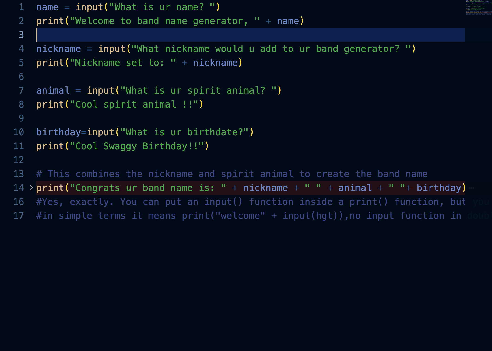
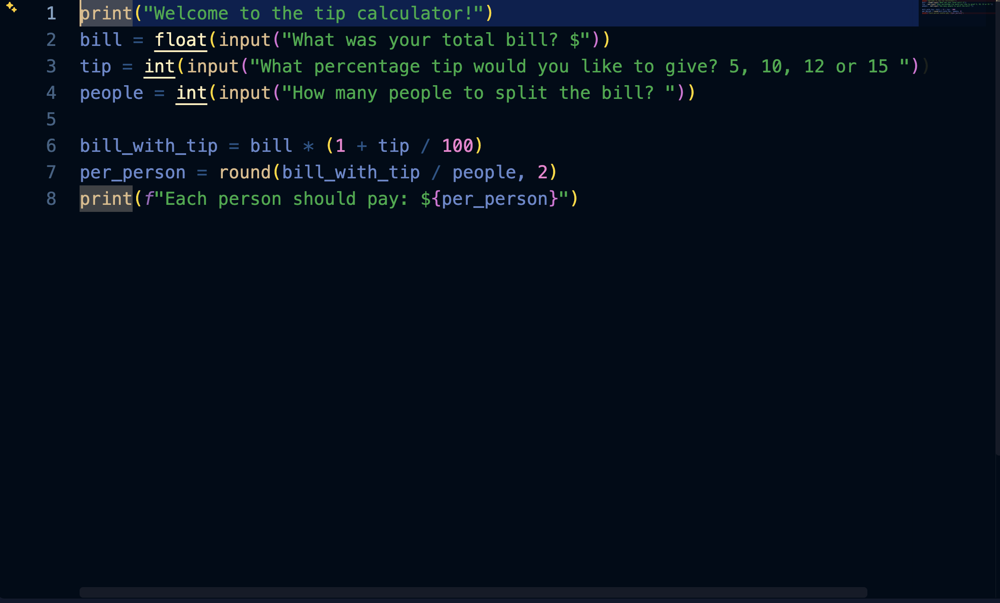

# Python Projects

Beginner projects from my first semester, built while learning Python.

## Password Generator
Creates a random password from the number of letters, symbols and digits you choose.

**Run it:**
python3 pypassword.py

**What I learned:** lists, loops, the random module and user input.

## Band Name Generator
Combines your nickname and spirit animal into a band name.

**Run it:** python3 band_name_generator.py

**What I learned:** input(), variables and string joining.

## Tip Calculator
Adds a tip to the bill and splits it between people.

**Run it:** python3 tip_calculator.py

**What I learned:** float and int conversion, f-strings and rounding.
