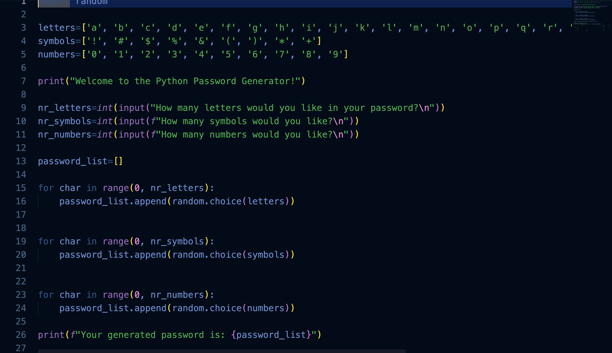

# Python Projects

Beginner projects from my first semester, built while learning Python.

## Password Generator
Creates a random password from the number of letters, symbols and digits you choose.

**Run it:**
python3 pypassword.py

**What I learned:** lists, loops, the random module and user input.

## More projects coming soon
